<picture>
  <source media="(prefers-color-scheme: dark)" srcset="./dark.svg">
  <source media="(prefers-color-scheme: light)" srcset="./light.svg">
  
</picture>

 

 

<picture>
  <source media="(prefers-color-scheme: dark)" srcset="https://newyear.1embergenovnurmurat1.workers.dev/?theme=dark">
  <source media="(prefers-color-scheme: light)" srcset="https://newyear.1embergenovnurmurat1.workers.dev/?theme=light">
  
</picture>

## Hi, I'm Nurmurat 👋

I'm a Python developer from Uzbekistan, currently learning Kotlin and Android development.

## About / Focus

- Building with **Python**, **HTML** and **CSS**
- Learning **Kotlin** and **Android development**
- Working in **IntelliJ IDEA**

## Engineering Stack

  <picture>
    <source media="(prefers-color-scheme: dark)" srcset="https://skillicons.dev/icons?i=python,html,css,kotlin,androidstudio,idea,git,github&theme=dark">
    
  </picture>

`Kotlin` and `Android` are still in progress — see the roadmap below.

## Learning Roadmap

- [ ] Kotlin basics: syntax, null safety, collections
- [ ] Kotlin OOP: classes, data classes, interfaces
- [ ] Android fundamentals: Activities, layouts, lifecycle
- [ ] Jetpack Compose basics
- [ ] First Android app published to GitHub

## GitHub Stats

<picture>
  <source media="(prefers-color-scheme: dark)" srcset="./stats-dark.svg">
  <source media="(prefers-color-scheme: light)" srcset="./stats-light.svg">
  
</picture>

## Contribution Snake

<picture>
  <source media="(prefers-color-scheme: dark)" srcset="https://raw.githubusercontent.com/Embergenov-Nurmurat/Embergenov-Nurmurat/output/github-snake-dark.svg">
  <source media="(prefers-color-scheme: light)" srcset="https://raw.githubusercontent.com/Embergenov-Nurmurat/Embergenov-Nurmurat/output/github-snake.svg">
  
</picture>

## Connect

- GitHub: [@Embergenov-Nurmurat](https://github.com/Embergenov-Nurmurat)
<!-- Add your own links here, for example:
- Telegram: [@your_username](https://t.me/your_username)
- LinkedIn: [your-name](https://www.linkedin.com/in/your-name)
-->
