<picture>
  <source media="(prefers-color-scheme: dark)" srcset="./dark.svg">
  <source media="(prefers-color-scheme: light)" srcset="./light.svg">
  
</picture>

## Hi, I'm Nurmurat 👋

I'm a Python developer from Uzbekistan, currently learning Kotlin and Android development.

## About / Focus

- Building with **Python**, **HTML** and **CSS**
- Learning **Kotlin** and **Android development**
- Working in **IntelliJ IDEA**

## Engineering Stack

`Python` · `HTML` · `CSS` · `Kotlin` *(learning)* · `Android` *(learning)*

## Connect

- GitHub: [@Embergenov-Nurmurat](https://github.com/Embergenov-Nurmurat)
